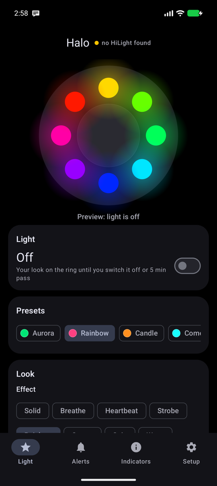
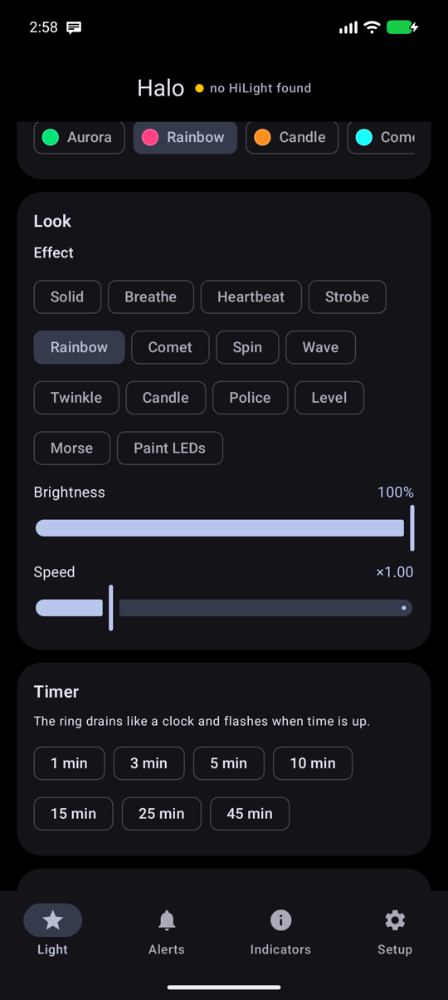
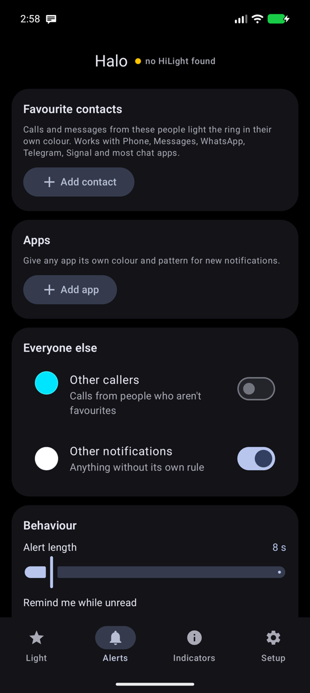
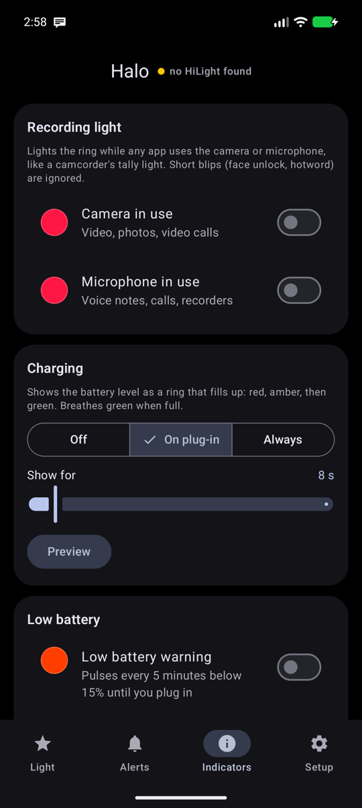
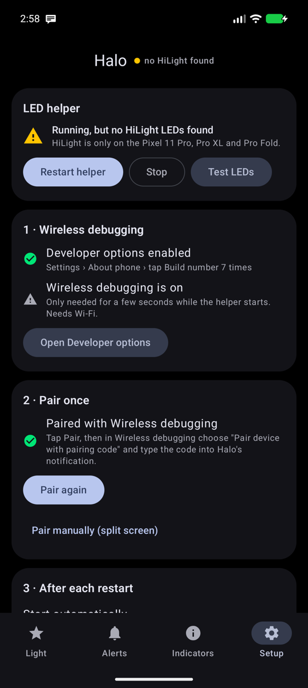

# Pixel Halo

Full control of **HiLight**, the ring of 8 RGB LEDs around the camera flash on the Pixel 11 Pro,
Pro XL and Pro Fold. Out of the box Google only uses it for favourite-contact calls, a few
messaging apps and Gemini. Halo lets you put any colour or animation on it, for anything.

**No computer, no root, no Shizuku.** Halo has a small ADB client built in that uses the
phone's own Wireless debugging.

> Not affiliated with or endorsed by Google. HiLight wasn't designed for hours of continuous light.
> Halo dims long, unbroken light by default (see [LED protection](#led-protection)).

<p align="center">
  
  
  
  
  
</p>

<sub>Screenshots from the Android 17 emulator, which has no HiLight hardware, hence "no HiLight found".</sub>

## Features

- **Live light:** any colour (hue/saturation/brightness, swatches or hex) with 15 effects: solid,
  breathe, heartbeat, strobe, rainbow, comet, spin, wave, twinkle, candle, police, level, countdown,
  Morse and paint-each-LED. Brightness and speed controls, saved presets.
- **Favourite contacts:** a colour and pattern per person, for calls and messages. Works with
  Phone, Messages, WhatsApp, Telegram, Signal and other apps that name the sender in the notification.
- **Per-app notification colours**, plus optional looks for other callers and other notifications.
- **Recording light:** lights while any app uses the camera or microphone.
- **Charging ring:** battery level as a filling ring, red → amber → green, breathing when full.
- **Low-battery warning**, **timer** (the ring drains like a clock), **SOS**, **Find my phone**.
- **Behaviour:** only when face down, only with the screen off, stop on screen-on, reminders while
  unread, respect Do Not Disturb, quiet hours, favourites break through.
- **Quick Settings tile** and an **automation broadcast** for Tasker, Home Assistant, Termux or adb.
- Dark Material You UI with a live preview of the ring.

## Why Wireless debugging?

HiLight is driven through Android's `lights` system service. Every call to it needs
`CONTROL_DEVICE_LIGHTS`, a signature/privileged permission that no Play Store app can hold. The
shell user (`adb shell`, uid 2000) already holds it. So Halo uses Wireless debugging once to start
a tiny renderer *as the shell user*, straight out of its own APK. That renderer then keeps
running until you restart the phone, even after Wireless debugging is turned off.

```
Halo app (normal app)                      LED helper (shell uid 2000)
 UI, contacts, app rules, indicators  ──►   reads state.json, renders ~30 fps
 writes state.json, reads status.json ◄──   ILightsManager → 8 HiLight LEDs
```

## Setup (about 2 minutes, on the phone)

1. Install the APK from [Releases](../../releases).
2. **Developer options:** Settings › About phone › tap *Build number* 7 times.
3. In Halo › **Setup**, tap **Pair**. Halo opens Developer options and shows a notification.
4. Open **Wireless debugging** (needs Wi-Fi), turn it on, then tap **Pair device with pairing code**.
5. Pull down the notification shade and type the 6-digit code into Halo's notification.
6. Halo pairs and starts the LED helper. Grant **Notification access** when asked.

**After each restart:** switch Wireless debugging on (from Settings or its Quick Settings tile).
Halo notices and starts the helper by itself. You can then switch Wireless debugging off again,
or let Halo do it (Setup › *Turn Wireless debugging off after starting*). Keep **USB debugging**
on in Developer options, because switching it off stops the helper.

### From a computer instead (optional)

```bash
scripts/halo-adb.sh start     # or: adb shell 'CLASSPATH=$(pm path com.shashankanil.halo | head -1 | cut -d: -f2) setsid nohup app_process /system/bin com.shashankanil.halo.core.HelperMain > /data/local/tmp/pixel-halo.log 2>&1 < /dev/null &'
scripts/halo-adb.sh status
scripts/halo-adb.sh stop
```

## Automation

Turn on Indicators › **Automation**, then from Tasker / MacroDroid / Termux / adb:

```bash
am broadcast -n com.shashankanil.halo/.AutomationReceiver -a com.shashankanil.halo.SET \
  --es color "#ff00aa" --es effect breathe --ei seconds 30
am broadcast -n com.shashankanil.halo/.AutomationReceiver -a com.shashankanil.halo.OFF
```

Extras: `color`, `color2` (`#rrggbb` or a colour name), `effect` (`solid breathe pulse strobe
rainbow chase spin wave twinkle candle police fill morse custom`), `brightness` (0–100), `speed`,
`text` (Morse), `value` (0–100, for `fill`), `seconds` (0 = until auto-off), `preset` (a saved
preset's name).

## LED protection

On by default, and enforced by the renderer:

- After 20 s of unbroken light, brightness eases down to 55 %.
- The live light switches itself off after 5 minutes (choose 1–60).
- The light session is only held while something is showing. When the ring goes dark, it's
  handed straight back to Android, so Google's own call and Gemini effects keep working.

## Build

```bash
./gradlew testDebugUnitTest assembleDebug     # JDK 21, Android SDK platform 37
```

## Credits

The hardware findings (8 addressable `LIGHT_TYPE_APPLICATION` lights, the shell user holding
`CONTROL_DEVICE_LIGHTS`) come from [HiLight Studio](https://github.com/DhananjayBhosale/hilight-studio)
(MIT). Wireless debugging pairing uses [libadb-android](https://github.com/MuntashirAkon/libadb-android)
(Apache-2.0).

## License

MIT
